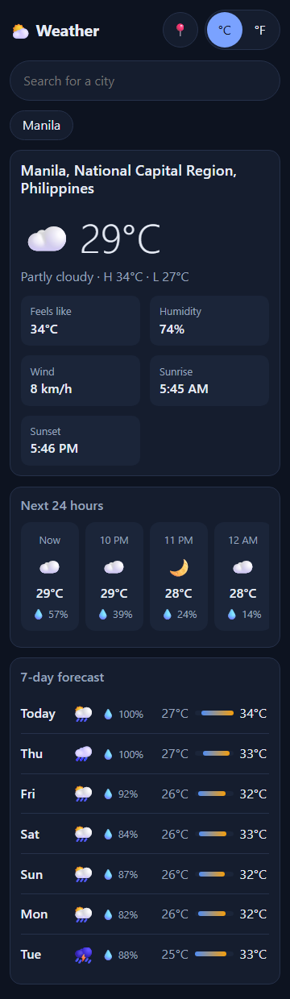
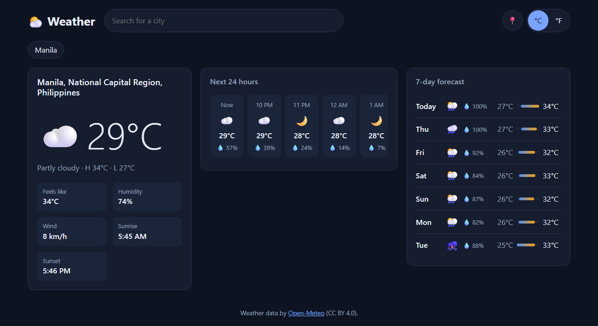

# Responsive Weather Dashboard

[](https://github.com/Nexude-ZainaV/responsive-weather-dashboard/actions/workflows/ci.yml)


**Live demo:** https://nexude-zainav.github.io/responsive-weather-dashboard/?city=Manila

Current conditions, the next 24 hours and a 7-day forecast for any city, in vanilla
HTML, CSS and JavaScript (ES modules, no framework, no build step). Data comes from
the free [Open-Meteo](https://open-meteo.com/) API, so no API key is needed.

| Phone (360px) | Desktop (1280px) |
|---|---|
|  |  |

## Features

- City search with autocomplete (ARIA combobox: arrow keys, Enter, Escape)
- "Use my location" through the Geolocation API
- °C / °F toggle (wind switches between km/h and mph with it)
- 24-hour strip with scroll snapping, 7-day list with temperature range bars on a
  shared weekly scale
- Recent places and the unit choice remembered in `localStorage`
- Shareable deep links: `?city=Tokyo`
- Light and dark themes from `prefers-color-scheme`; motion off for `prefers-reduced-motion`

## Responsive approach

Mobile first: the base CSS targets phones, and `min-width` queries add layout.

| Breakpoint | Devices | Layout |
|---|---|---|
| < 600px | phones | header on two rows, cards stacked |
| 600px | large phones, small tablets (portrait) | header on one row |
| 900px | tablets (landscape), small laptops | current + hourly side by side, 7-day full width |
| 1200px | desktops | three columns |

Between breakpoints, fluid sizing does the work: `clamp()` for type and spacing,
`repeat(auto-fit, minmax())` grids, `100dvh` so mobile browser bars don't cause
overflow, and `minmax(0, 1fr)` columns so long content can't push the page sideways.
Touch targets are at least 44px.

## How it works

```
index.html               semantic markup, landmarks, live region for status messages
src/js/main.js           state and events: search, geolocation, units, deep link
src/js/api.js            Open-Meteo client: timeouts, cancellation, friendly errors
src/js/render.js         DOM building with textContent only (no innerHTML, no XSS)
src/js/format.js         pure formatting functions (tested)
src/js/storage.js        guarded localStorage with validation of stored data (tested)
src/js/weather-codes.js  WMO weather code -> label and icon
src/css/styles.css       design tokens, mobile-first layout
```

Network details worth noting:

- **Every request has a timeout** (`AbortSignal.timeout`) and a caller signal, combined
  with `AbortSignal.any`.
- **Stale requests are cancelled.** Typing "Lon" then "London" aborts the "Lon" lookup,
  so an older, slower response can never overwrite a newer one.
- **Search is debounced** (300ms) so the geocoding API is called once per pause, not
  once per keystroke.

## Run it

Any static file server works (ES modules don't load from `file://`):

```bash
npm start                      # npx http-server on http://localhost:5173
# or
python -m http.server 5173
```

Tests use Node's built-in test runner (Node 22+), with a fake `fetch` and fake storage:

```bash
npm test
```

Pushes to `main` run the tests and deploy the site to GitHub Pages.

## License

[MIT](LICENSE). Weather data by Open-Meteo, [CC BY 4.0](https://creativecommons.org/licenses/by/4.0/).
